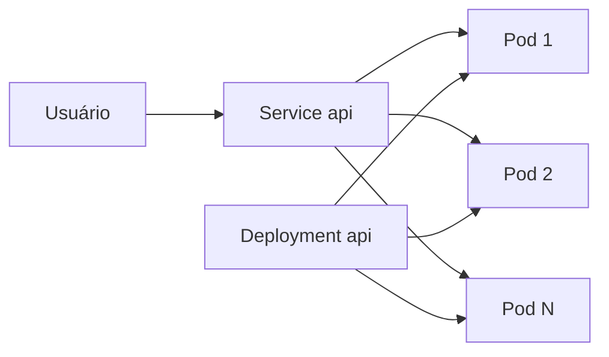

# Infraestrutura como Código

## 1. Estrutura

```
infrastructure/
 ├── ansible/      # 1º prepara o ambiente e gera a imagem da API
 ├── terraform/    # 2º cria o container da API
 └── kubernetes/   # 3º roda a API como workload no cluster
```

## 2. Terraform

Arquivo: `main.tf`.

Usa o provider Docker para subir o container da API na porta 3000.

Vantagens da IaC:

- **Versionamento**: a infraestrutura fica no Git junto com o código.
- **Replicabilidade**: o mesmo `apply` gera o mesmo ambiente em qualquer máquina.
- **Destruição controlada**: `terraform destroy` remove só o que foi criado.

## 3. Ansible

Arquivo: `playbook.yml`.

O playbook prepara o ambiente:

1. Verifica se o Docker está instalado.
2. Gera a imagem `faculdade-ava1-api:latest`, usada pelo Terraform e pelo Kubernetes.

## 4. Kubernetes

Tudo fica em `deployment.yaml`:

| Requisito       | Como foi atendido                              |
| --------------- | ---------------------------------------------- |
| Réplicas        | `replicas: 1`                                  |
| Serviço         | `Service` NodePort apontando para a porta 3000 |
| Configuração    | variável `NODE_ENV` via `env`                  |
| Disponibilidade | `livenessProbe` em `/products`                 |

## 5. Escalabilidade

```
1 réplica  →  3 réplicas  →  10 réplicas
```

```bash
kubectl scale deployment api --replicas=1
kubectl scale deployment api --replicas=3
kubectl scale deployment api --replicas=10
kubectl get pods
```

- **Self-healing**: se um pod cair, o Deployment cria outro para manter o número de réplicas. A `livenessProbe` reinicia o container quando a API para de responder.
- **Auto-scaling**: em vez do `kubectl scale` manual, um HorizontalPodAutoscaler (HPA) aumenta ou diminui as réplicas sozinho conforme o uso de CPU. Exemplo (requer metrics-server no cluster):

```bash
kubectl autoscale deployment api --min=1 --max=10 --cpu-percent=70
```

Teste de self-healing:

```bash
kubectl delete pod <nome-do-pod>
kubectl get pods   # um novo pod é criado automaticamente
```

## 6. Diagrama



## 7. Evidências

Salvar os prints em `docs/evidencias/`:

- [ ] `ansible-playbook`
- [ ] `terraform apply`
- [ ] `kubectl get pods` com 1, 3 e 10 réplicas
- [ ] pod recriado após `kubectl delete pod`
